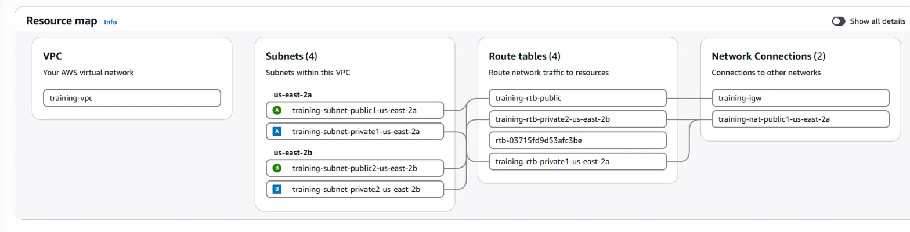

Whaat is Internet Gateway, NAT Gateway, Bastion host pattern.

Internet Gateway (IGW)

The door between your VPC and the internet. One per VPC, attached at the VPC level, free. It does two things: routes traffic out, and performs NAT for instances that have public IPs — translating between the instance’s private address (10.0.1.5) and its public one. It's quite literal in it's name, its how public (internal networks) communicate with external networks (the internet)

Instances with a public IP use this. Each one has its own public address, permanently mapped to its private one. One-to-one. Dedicated. Because the mapping is permanent and public, anyone on the internet can reach 54.23.1.9 and get to the bastion. Inbound works. The IGW does this translation automatically for any instance that has a public IP. You don’t configure it.

NAT Gateway

Lets private instances reach out without being reachable in. The problem it solves: your database server needs dnf update and needs to call an API. But giving it a public IP means anyone on the internet can try to connect to it. Instances without a public IP use this. They have no address of 
their own to translate to, so they borrow the NAT’s.

Many-to-one. Shared. The NAT keeps a table of which outbound connection belonged to which instance, so replies get routed back correctly. Inbound can’t work here, because 3.15.88.2 doesn’t identify any single instance. An unsolicited packet arriving there has no entry in the table, so the NAT doesn’t know who it’s for and drops it.

But one thing to mention: NAT ──> IGW ──> internet. It always goes through the IGW, even if it already has a NAT Gateway, meaning it tranlates the IP address twice. 

Bastion

A small EC2 instance whose only purpose is to be the one machine you’re allowed to SSH into from outside. Nothing runs on it. No application, no database. It’s a doorway. The name comes from fortification — a bastion is the projecting part of a wall where defenses are concentrated.

Regarding the networking:

Every instance in private1 follows whatever table private1 is associated with. No exceptions, no per-instance overrides. What doesn’t inherit is the subnet-to-table link itself. That’s the distinction the debug lab is making. A subnet is associated with exactly one route table. If nobody explicitly associates it, it falls back to the VPC’s main route table — which has no internet route.

training-igw — the Internet Gateway. The actual exit from your VPC. Attached at the VPC level.

training-nat-public1-us-east-2a — the NAT Gateway. Sits in public1, relays outbound traffic for private instances.

AWS groups them under that heading because both are route targets — things a route table can point 0.0.0.0/0 at. Subnets and route tables are internal; these two are the doors. These are called internet gateways (imagine just like NAT ports)

The NAT’s own route to the IGW isn’t drawn because the NAT sits inside public1, and public1’s connection to the IGW is already on the diagram. The NAT uses that same path as any other resource in that subnet. It’d be a redundant line.