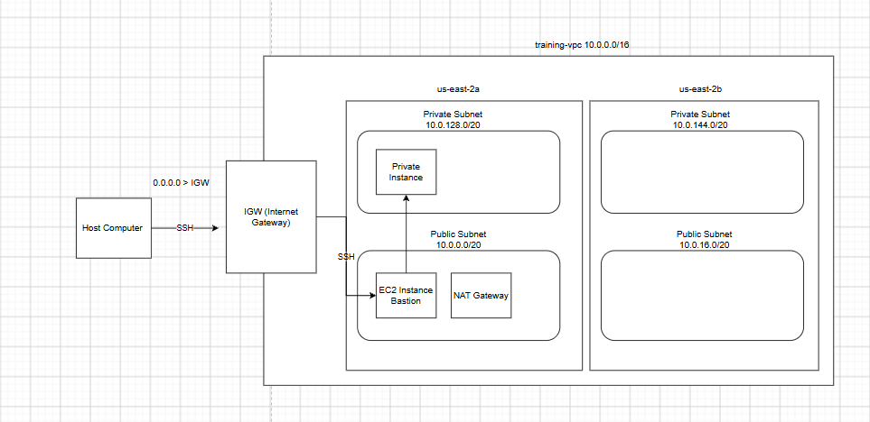

SSH from my desktop hits the bastion’s Elastic IP 3.151.26.120. The IGW translates it to 10.0.15.96 and delivers it to the public subnet, where the bastion’s security group allows port 22 from my IP.

From the bastion, a second SSH goes to 10.0.143.154. Both are inside 10.0.0.0/16, so the local route keeps this traffic entirely inside the VPC (no IGW involved). The private instance’s security group allows port 22 with the bastion’s security group as the source.

Authentication on hop two uses agent forwarding, so my key never touches the bastion.