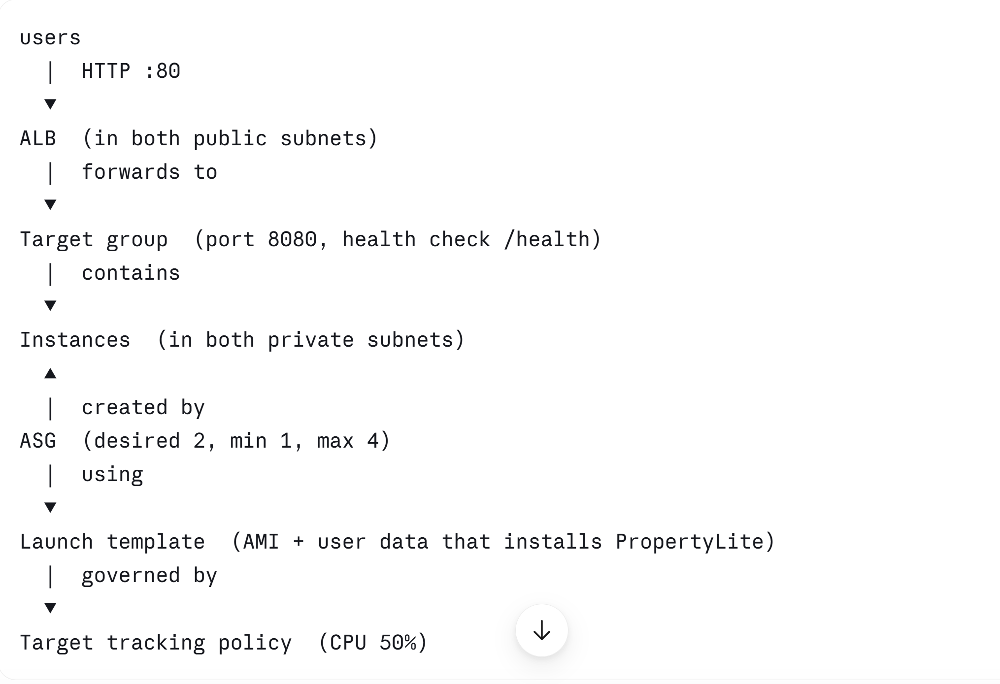

ALB
 A managed service that sits in front of your instances and distributes incoming requests across them. The ALB solves the issue of one public IP being frontloaded with a lot of work just for on instance. It gets one DNS name (training-alb-123456.us-east-2.elb.amazonaws.com), users only ever talk to that, and the ALB decides which instance behind it handles each request. Instances come and go without anyone noticing.

Target group
The list of things the ALB can send traffic to, plus the rules for checking whether each one is working.

The ALB has listeners (e.g. “listen on port 80”) and each listener forwards to a target group. 

A target group specifies:

Target type — instance, IP, or Lambda
Protocol and port — yours will be HTTP on 8080, since PropertyLite listens there, not 80
Health check settings — below

Health checks
The ALB repeatedly requests a URL on each target and decides from the response whether that target is healthy.

Launch template
A saved blueprint for creating EC2 instances: AMI, instance type, key pair, security groups, user data script, IAM role, storage.

ASG — Auto Scaling Group

The thing that keeps a desired number of instances running, launching and terminating them as needed.

Three numbers define it:

Minimum — never go below this
Maximum — never go above this
Desired — how many right now

