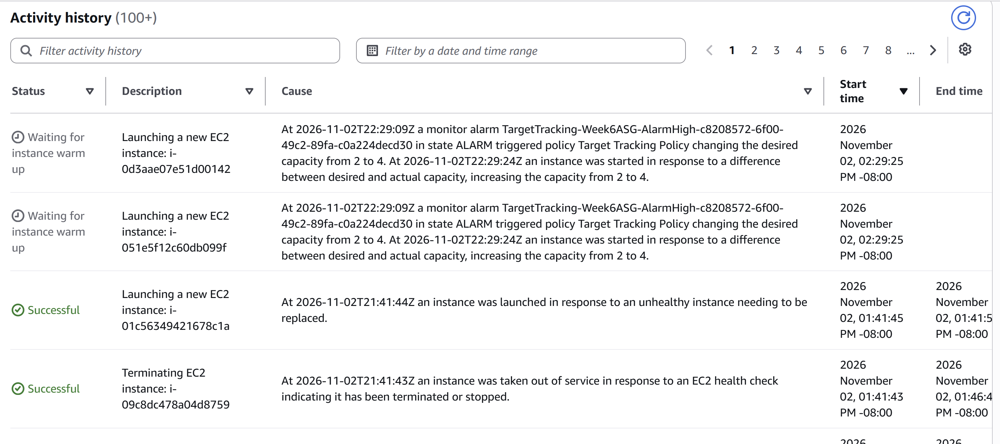
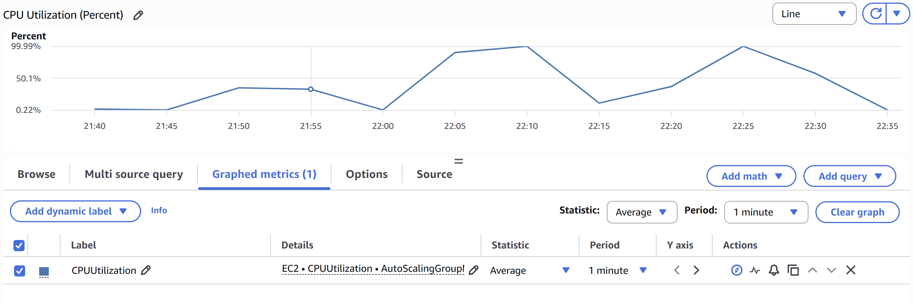

22:00    stress-ng started on both instances (CPU at baseline ~1%)
22:05    group average CPU crossed 50% — reached ~90%
22:10    CPU peaked at ~99%
22:29:09 TargetTracking-Week6ASG-AlarmHigh entered ALARM state
22:29:09 Policy raised desired capacity 2 → 4 (jumped 2 steps, not 1)
22:29:24 Two instances launched: i-0d3aae07e51d00142, i-051e5f12c60db099f
22:29:25 Both entered "Waiting for instance warm up" (300s)

It hit 99% at 22:10, dropped to ~10% at 22:15, climbed again, peaked at 22:25. This is the result of testing it three times. At ~99% across 2 instances, doubling to 4 is the because I ran the CPU spike on both instances. 