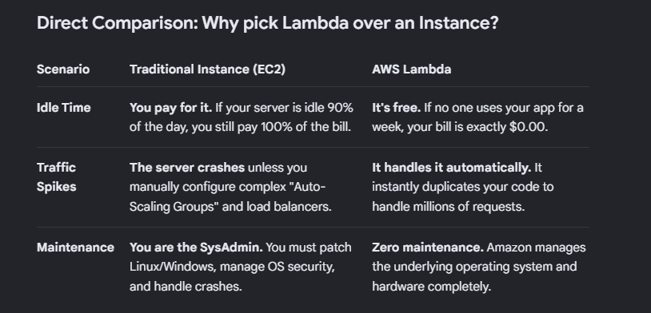
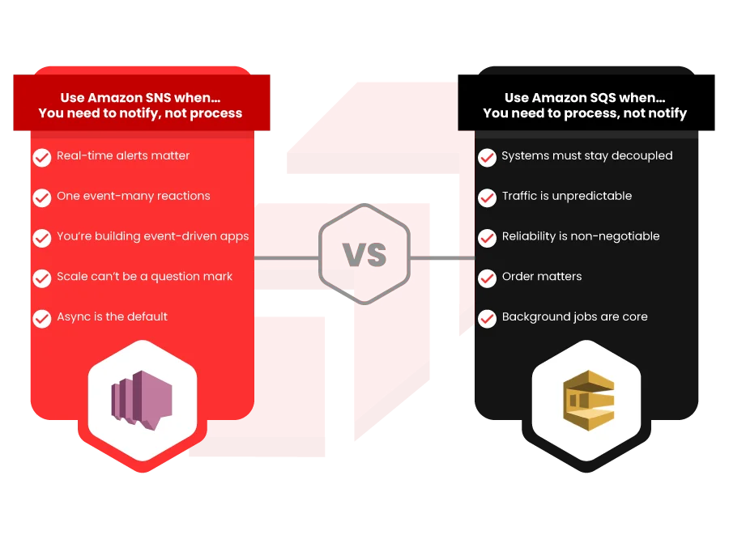

Concepts: Lambda execution model, cold starts, API Gateway, SQS (with dead-letter queues), SNS

Lambda
Run code without a server. You upload a function, AWS runs it when something triggers it, and you pay per invocation and per millisecond of execution. no instance to patch, no ASG, no load balancer. Zero requests means zero cost. The limit to run a function is also 15 minutes.

An event arrives (HTTP request, queue message, file upload, timer)
AWS finds or creates an execution environment — a micro-VM with your code in it
Your handler function runs
The environment stays warm for a while, ready for the next event
Idle long enough, it’s torn down

API Gateway
An API Gateway is a management tool that sits between a client (like a mobile app or website) and your backend services (like Lambda). Puts an HTTP endpoint in front of Lambda (or other backends). Lambda has no URL of its own — API Gateway provides one.

It also handles authentication, rate limiting, request validation, CORS, and stages (dev/prod). Roughly: it’s to Lambda what the ALB was to your EC2 instances.

Two flavors: HTTP API (cheaper, faster, fewer features — what your lab uses) and REST API (more features, more expensive).

SQS
Say your app lets users upload photos, and each upload needs a thumbnail generated. Thumbnail generation takes 10 seconds.

The obvious way: the web server receives the upload and generates the thumbnail right there. But now the user waits 10 seconds staring at a spinner. And if 500 people upload at once, your server is doing 5,000 seconds of work and falls over. And if the thumbnail code crashes, the user’s upload is lost entirely.

What a queue is
A list of pending work items, stored somewhere outside both programs. Basically, when requests are sent to the webserver, instead of having that web server generate everything at the spot, it creates like a note (usually JSON) and tells some other process/service that is dedicated to handling those notes. A message is one of those notes. Just a small piece of text, usually JSON, describing something that needs doing.

{"order_id": "ORD-48812", "event": "payment_confirmed"}
{"bucket": "uploads-prod", "key": "users/8821/raw.mp4"}
{"user_id": 44102, "template": "welcome_email"}

Dead-letter queue. Suppose one message is malformed and crashes the worker every time. Without a DLQ it reappears forever, blocking progress. maxReceiveCount: 3 says: after three failures, move it to a separate queue. The main queue keeps flowing, and the bad message sits somewhere you can go look at it. 

Amazon Simple Queue Service (SQS) is a fully managed message queuing service provided by Amazon Web Services (AWS) that lets you decouple and scale microservices, distributed systems, and serverless applications. The point is decoupling. If your image processor is down, uploads still queue up and get handled when it recovers. If a traffic burst arrives, the queue absorbs it instead of overwhelming the consumer. That’s the point of SQS. Not that you can’t call directly — that calling directly makes you responsible for all the failure handling yourself.

SNS
Amazon Simple Notification Service (AWS SNS) is a fully managed publish/subscribe (pub/sub) messaging service provided by Amazon Web Services that delivers messages from producers to multiple subscribers

