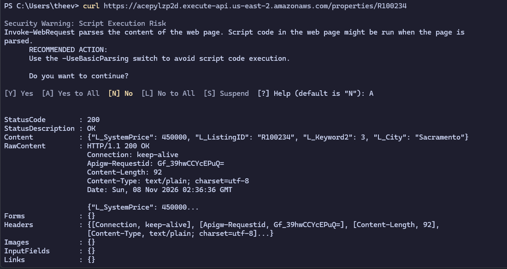
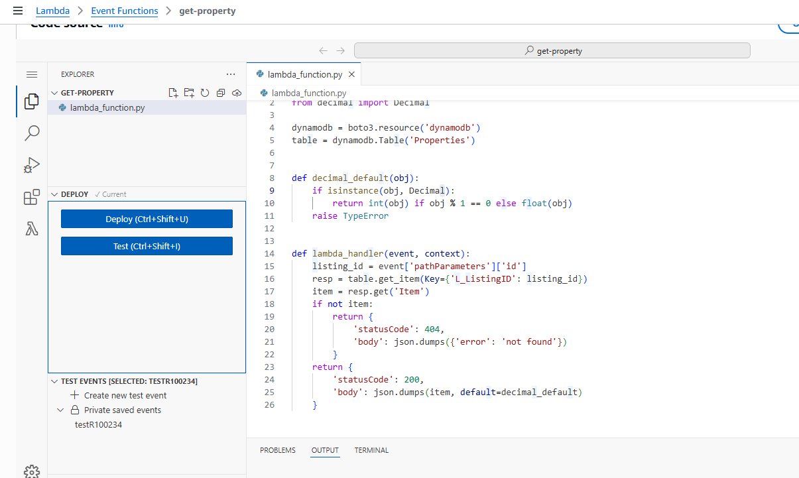
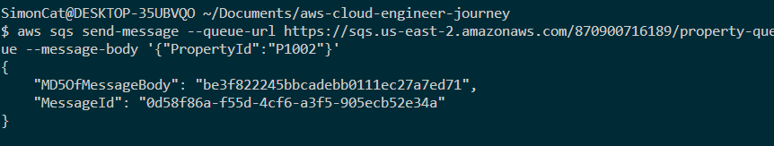
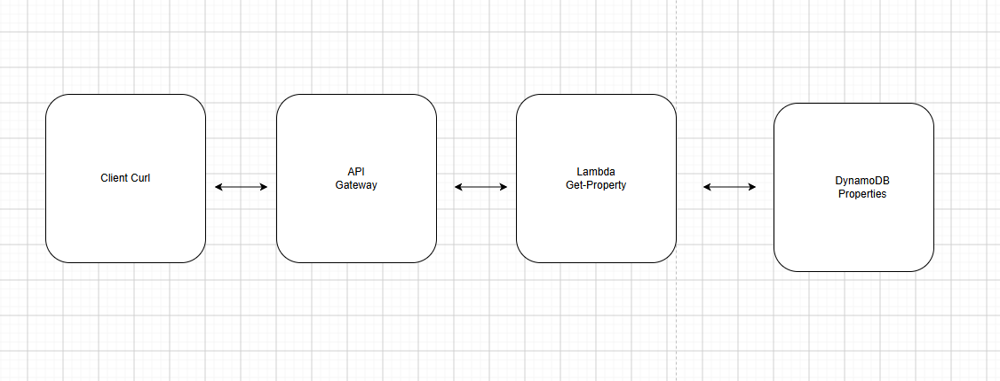

You’re receiving manually and never deleting, so every receive-message call bumps the counter. Three of those and your message lands in the DLQ — not because anything failed, but because you never acknowledged it.

