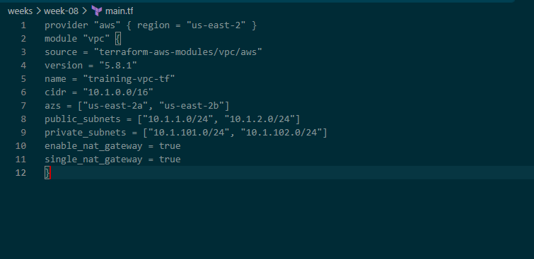

plan
The dry run. Terraform does a three-way comparison:
your .tf files      — what you want
state file          — what Terraform believes it built
live AWS            — what's actually there (queried fresh)

apply
Runs a plan, shows it, waits for you to type yes, then executes.
It creates resources in dependency order, derived from your references. The VPC before the subnets, because the subnets reference aws_vpc.main.id. Independent resources are created in parallel.
As each one succeeds, its real AWS ID gets written into the state file. If apply fails halfway, state still records everything that did get created, so a re-run picks up from there rather than starting over.

destroy
Deletes everything in state, in reverse dependency order. Subnets before the VPC. NAT gateway before the subnet it lives in. This is the one that makes Week 5’s cleanup look bad by comparison.

Why state matters
Without state, Terraform looks at your config and has no idea whether any of it exists yet. Apply twice, get two VPCs.