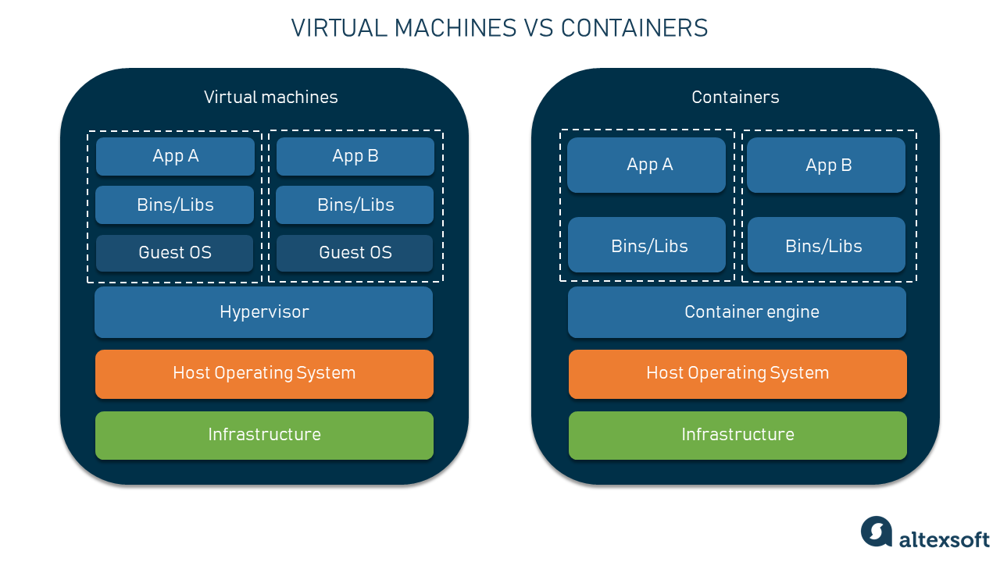
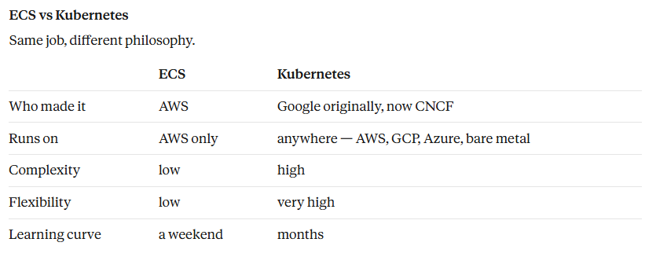

Dockerfile  = a text file you write (instructions)
image       = what `docker build` produces (a frozen filesystem)
container   = a running process using that image

Container 
A container flips it: you build the environment once, freeze it, and ship the frozen thing. Every copy that runs is byte-identical to what you tested. Essentially, insteasd of running a boot script fresh every time, we ship a running instance of that script. 

Image
A filesystem snapshot plus a startup command. There’s no kernel inside, no boot process, no virtual hardware. It’s a tarball of directories — /usr, /lib, /app — that gets mounted as the root filesystem for a process.

Layers
Docker layers are stacked, read-only sets of filesystem changes that make up a container image.
Layers live inside the image. Not in the Dockerfile, not in the container. Each instruction in the Dockerfile produces one layer. A layer is a record of what changed on disk when that instruction ran.

FROM python:3.12-slim          → layer 1
COPY requirements.txt .        → layer 2
RUN pip install -r req.txt     → layer 3
COPY app.py .                  → layer 4

Layer 1 — a whole Debian filesystem with Python in it. /usr, /bin, /lib, everything. ~130 MB.
Layer 2 — one file: /app/requirements.txt. About 20 bytes.
Layer 3 — whatever pip created: /usr/lib/python3.12/site-packages/flask/, werkzeug/, jinja2/, etc. A few MB.
Layer 4 — one file: /app/app.py.

So no, not “an image of files” each time. Only the difference that instruction made. 

You edit app.py and run docker build again. Docker goes through the steps asking “has anything changed that affects this?”

Step 1: no → reuse the saved result
Step 2: requirements.txt unchanged → reuse
Step 3: nothing above changed → reuse
Step 4: app.py changed → redo this one

ECR (Elastic Container Registry)
AWS’s private storage for Docker images. You build an image on your machine. It exists on your laptop’s disk. ECS Fargate needs to run it but Fargate is somewhere in AWS, and it can’t reach your laptop. Think of it as GitHub, but for Docker images instead of code. You push images up, they sit there, other things pull them down.

ECR doesn’t run anything. It’s a hard drive with an API. docker push  →  ECR  →  image sits in storage

ECS (Elastic Container Service)
Execution. The thing that actually runs containers. You tell ECS “run this image, 2 copies, on this network, with this much CPU and memory.” It pulls the image from ECR and runs it. It restarts containers that crash, scales them, and registers them with a load balancer. ECS is the Week 6 Auto Scaling Group, but for containers instead of EC2 instances.

ECS is AWS’s container orchestrator, and Kubernetes is the right comparison.

ECS Fargate vs EC2 launch type
Not three things. One thing with a setting.

ECS  ──  the orchestrator (runs and manages your containers)
 │
 └── launch type: ← a choice you make
       ├── Fargate   (AWS provides the machines)
       └── EC2       (you provide the machines)

An Amazon ECS task definition is a text file in JSON format that acts as a blueprint for your application. It tells Amazon Elastic Container Service (ECS) how to run your Docker containers. Think of a task definition like a recipe, a job description, or a docker-compose file. An ECS task is the actual running instance of that blueprint, and an ECS service manages how many copies of that task run continuously.