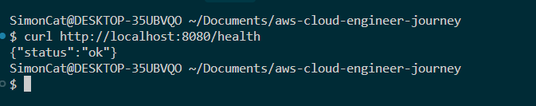
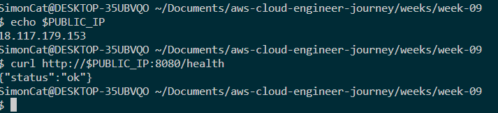
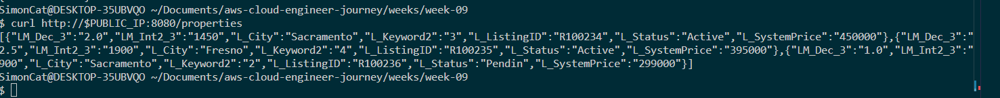
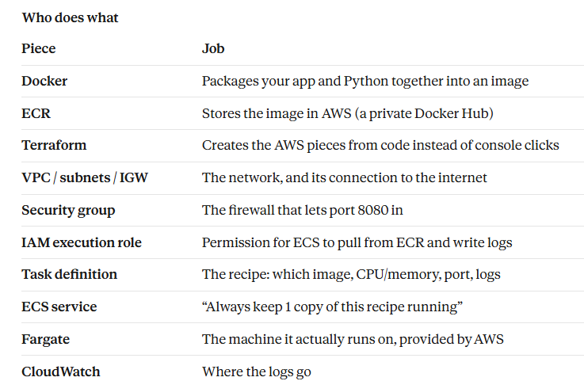

Inside the container, your app opens the port. python3 app.py starts the server and it listens on port 8080. The container has its own network namespace: its own IP (something like 172.17.0.2), its own localhost, and its own ports. So your service is on port 8080 of the container, not of your laptop. Docker doesn’t open that port. Your Python code does, and Docker doesn’t know or care which port the app picks.

ACCT=$(aws sts get-caller-identity --query Account --output text)
REPO=$ACCT.dkr.ecr.us-east-2.amazonaws.com/property-api

aws ecr create-repository --repository-name property-api --region us-east-2
aws ecr get-login-password --region us-east-2 | docker login --username AWS --password-stdin $ACCT.dkr.ecr.us-east-2.amazonaws.com
docker tag property-api:latest $REPO:latest
docker push $REPO:latest

The property-api image is what we essentially push, and the process of the commands is just getting our IDs and creating a repository on ECR. We create the image locally, then we push it to ECR. 

TASK_ARN=$(aws ecs list-tasks --cluster training-cluster --query "taskArns[0]" --output text --region us-east-2)

ENI_ID=$(aws ecs describe-tasks --cluster training-cluster --tasks $TASK_ARN \
  --query "tasks[0].attachments[0].details[?name=='networkInterfaceId'].value" \
  --output text --region us-east-2)

PUBLIC_IP=$(aws ec2 describe-network-interfaces --network-interface-ids $ENI_ID \
  --query "NetworkInterfaces[0].Association.PublicIp" --output text --region us-east-2)

echo $PUBLIC_IP

1. BUILD      your laptop:  Dockerfile + app.py ──docker build──▶ image
2. UPLOAD     your laptop ──docker push──▶ ECR (image storage in AWS)
3. SET UP     terraform apply ──▶ creates network, firewall, permissions,
                                   recipe, and "keep 1 running" instruction
4. RUN        ECS sees the instruction ──▶ Fargate machine pulls image
                                           from ECR and starts it
5. LIVE       anyone ──▶ http://<public IP>:8080 ──▶ your app answers

Is Fargate an EC2 instance? More or less, under the hood. Fargate runs on AWS’s own EC2 hardware, but those machines are in AWS’s accounts, not yours. Each task gets its own isolated virtual machine, which AWS creates, patches, and deletes. You never see it in your EC2 console, can’t SSH into it, and don’t pay for it as an instance. You pay for the 0.25 vCPU / 512 MB your task asked for, per second.

So it’s still EC2 underneath. The difference is that AWS manages it, not you.

Why not just use your own EC2 instance? You can. There are three ways to run your container on AWS:

Option	What you do	What AWS does
A. Plain EC2, no ECS	Launch an instance, install Docker, SSH in, docker run -p 8080:8080	Gives you the VM
B. ECS + EC2 launch type	Launch and patch the instances, size them, scale them	ECS starts and restarts containers on your instances
C. ECS + Fargate	Write the task definition	Provides the machine and starts and restarts containers

Fargate essnetially just creates the EC2 instance for you. 